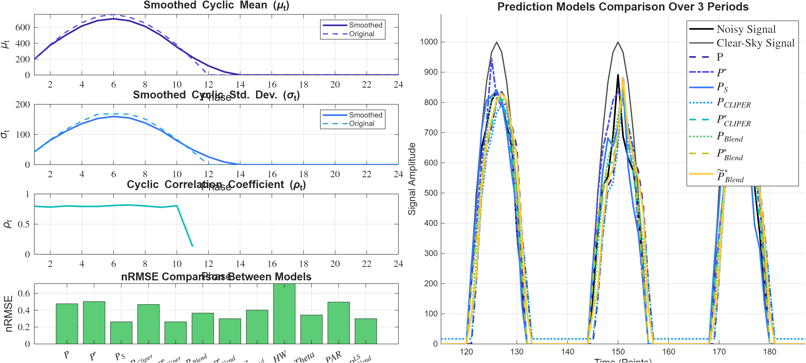

# Cyclostationary Forecasting — BLEND & CLIPER Operators (MATLAB)

[](https://doi.org/10.5281/zenodo.18812333)
[](https://archive.softwareheritage.org/swh:1:dir:ffac5b7434f6ca87f99f246804225ed1d4d45954;origin=https://github.com/cyrilvoyant/cyclostationary-forecasting-matlab;visit=swh:1:snp:cdad432d0cc2081cc34205e770fb0ae778a8392a;anchor=swh:1:rev:1a1ad1ed2055f0b24693ba89f313e607315438be;path=/)
🔗 **Project page:** [https://www.cyrilvoyant.com/...](https://www.cyrilvoyant.com/latest-publications-and-news)

> **A new, frugal persistence operator that exploits the cyclostationarity of energy processes**  
> Closed-form, MSE-optimal, no iterative training — companion code for the peer-reviewed publication in *Applied Mathematical Modelling*

> **v1.1.0 (October 2026) — causal alignment and λ fix.** Earlier versions leaked the target into some forecasts. See [What changed in v1.1.0](#-what-changed-in-v110) and the full results table below.

[](https://www.mathworks.com/)
[](LICENSE)
[](https://arxiv.org/abs/2602.18949)
[]()

---

## 📄 Reference Paper

**Symmetry-Constrained Forecasting of Periodically Correlated Energy Processes**  
*Cyril Voyant, Candice Banes, Luis Garcia-Gutierrez, Gilles Notton, Milan Despotovic, Zaher Mundher Yaseen*  
Applied Mathematical Modelling — 2026

🔗 **[Read the paper on arXiv](https://arxiv.org/abs/2602.18949)**

---

## 🧭 Overview

Time series from energy systems — **solar irradiance**, **wind speed**, **electrical load** — exhibit strong diurnal and seasonal periodicities. Classical persistence models assume stationarity and rapidly lose accuracy beyond intra-hour horizons.

**This is not another forecasting model bolted onto persistence — it is a new persistence operator in its own right.** Instead of adding external inputs, training, or a physical model, it exploits a structural property already present in the signal: its **cyclostationarity** (the fact that mean, variance, and covariance repeat periodically rather than staying constant). By conditioning persistence on the phase of the cycle, the operator stays exactly as **frugal** as classical persistence — no training, no external data, no fitted parameters — while recovering most of the accuracy of far more expensive models. This repository implements this family of **analytical, training-free forecasting operators** for **cyclostationary processes**. The key contribution is the **BLEND operator family**, which optimally combines:

- **Simple Persistence** `P` — current observation as forecast
- **Cyclic Persistence** `P⟲` — phase-aligned observation from the previous cycle

The weight of the cyclic term is the MSE-optimal value for each phase of the cycle, written with the cyclic means, standard deviations and correlations (`P⟲_BLEND`). The same weight is obtained directly by a one-line least-squares fit per phase (`P^LS_BLEND`). The simplified coefficient `λ̃ = (1 + ρ)/2` (`P̃⟲_BLEND`) is kept as an approximation; it only helps at the shortest horizons.

---

## 🔧 What changed in v1.1.0

- **Causal alignment.** In v1.0.0, `predict_P_BLEND_Tilde.m`, `predict_P_BLEND_Cyclo.m`, `predict_HW.m` and `predict_Theta.m` stored the forecast of `t + h` at index `t` while using `x(t)`, so the score compared the forecast with an already known value. Forecasts are now stored at `t + h`. Theta uses a trailing (causal) moving average.
- **BLEND weight.** λ now weights the cyclic term `x(t + h − T)`, as in the paper's eq. 16. In `P⟲_BLEND` it is the MSE-optimal weight `E[(y − r)(c − r)] / E[(c − r)²]` (`y = x(t+h)`, `r = x(t)`, `c = x(t+h−T)`).
- **Cyclic correlations.** `cyclic_parameters.m` now pairs the right cycles when a lag crosses the period; in v1.0.0 the lag-T correlation was identically 1.
- **PAR.** Inputs are `x(t − T), …, x(t − pT)`, consistent with how the coefficients are fitted.
- **New operator.** `predict_P_BLEND_LS.m`: one least-squares weight per phase, closed form, clipped to [0, 1].
- The results published in the paper come from a separate pipeline and are not affected by this repository's indexing.

---

## 🏗️ Repository Structure

```
cyclostationary-forecasting-matlab/
│
├── main.m                      # 🚀 Main script — run this to reproduce results
├── cyclic_parameters.m         # Core: computes cyclic mean, std, correlations
│
├── predict_P.m                 # Simple Persistence (baseline)
├── predict_P_cyclic.m          # Cyclic Persistence
├── predict_P_smart.m           # Smart Persistence (clear-sky normalized)
│
├── predict_P_CLIPER_Statio.m   # CLIPER — stationary assumption
├── predict_P_CLIPER_Cyclo.m    # CLIPER — cyclostationary assumption
├── predict_P_CLIPER_Tilde.m    # CLIPER — simplified cyclostationary
│
├── predict_P_BLEND_Statio.m    # BLEND — stationary assumption
├── predict_P_BLEND_Cyclo.m     # ⭐ BLEND — cyclostationary, MSE-optimal weight (P⟲_BLEND)
├── predict_P_BLEND_LS.m        # ⭐ BLEND — least-squares weight per phase (same result)
├── predict_P_BLEND_Tilde.m     # BLEND — simplified λ̃ = (1+ρ)/2 (short horizons only)
│
├── predict_HW.m                # Holt-Winters benchmark
├── predict_Theta.m             # Theta method benchmark
├── predict_PAR.m               # Periodic AutoRegressive (PAR) benchmark
│
└── subtightplot.m              # Figure layout utility (included for convenience)
```

---

## ⚡ Quick Start

### Requirements

- **MATLAB R2021a or later**
- Required toolboxes:
  - Statistics and Machine Learning Toolbox (`corr`, `cov`)
  - Signal Processing Toolbox (`autocorr`)
  - Curve Fitting Toolbox (`smooth`)

### Run

```matlab
% Clone the repository and run:
main
```

The script will:
1. Generate a synthetic cyclostationary time series (Algorithm 1 from the paper)
2. Compute cyclic parameters (mean, std, correlation) per phase
3. Run all forecasting operators
4. Compute nRMSE for each model
5. Plot the cyclic parameters and the model comparison (synthetic case, `n_delta_t = 1`)



---

## 📐 Forecasting Operators

| Function | Operator | Training | Complexity | Description |
|---|---|---|---|---|
| `predict_P.m` | P | None | O(1) | Simple persistence |
| `predict_P_cyclic.m` | P⟲ | None | O(1) | Cyclic persistence |
| `predict_P_smart.m` | Pˢ | O(ref) | O(1) | Clear-sky normalized |
| `predict_P_CLIPER_Statio.m` | P_CLIPER | O(n) | O(1) | Stationary CLIPER |
| `predict_P_CLIPER_Cyclo.m` | P⟲_CLIPER | O(nT) | O(T) | Cyclostationary CLIPER |
| `predict_P_CLIPER_Tilde.m` | P̃⟲_CLIPER | O(nT) | O(T) | Simplified CLIPER |
| `predict_P_BLEND_Statio.m` | P_BLEND | O(n) | O(1) | Stationary BLEND |
| `predict_P_BLEND_Cyclo.m` | **P⟲_BLEND** | **O(nT)** | **O(T)** | **⭐ MSE-optimal weight per phase** |
| `predict_P_BLEND_LS.m` | **P^LS_BLEND** | **O(n)** | **O(T)** | **⭐ Least-squares weight per phase** |
| `predict_P_BLEND_Tilde.m` | P̃⟲_BLEND | O(nT) | O(T) | Simplified weight (1+ρ)/2 |
| `predict_HW.m` | HW | O(n) | O(h) | Holt-Winters |
| `predict_Theta.m` | Theta | O(nk) | O(h) | Theta method |
| `predict_PAR.m` | PAR | O(np²T) | O(pT) | Periodic AR |

---

## 🔑 Key Mathematical Contribution

### The BLEND operator

The forecast is a convex combination of cyclic and simple persistence, with one weight per phase `k` of the cycle:

$$\hat{I}(t + h) = \lambda_k\, I(t + h - T) + (1 - \lambda_k)\, I(t)$$

The MSE-optimal weight (`P⟲_BLEND`) is

$$\lambda_k = \frac{\mathbb{E}[(y - r)(c - r)]}{\mathbb{E}[(c - r)^2]}, \quad y = I(t+h),\; r = I(t),\; c = I(t+h-T)$$

expanded with the cyclic means, standard deviations and correlations of phases `t` and `t + h`. Fitting the same ratio on past data (`P^LS_BLEND`) is a one-line least-squares regression per phase. The simplified weight `λ̃ = (1 + ρ)/2` assumes equal means and variances at `t` and `t + h`, which fails on a solar cycle beyond one or two steps.

**Properties:**
- ✅ **No iterative training, no external data** — cyclic statistics or a closed-form 1-D fit per phase
- ✅ **Adapts to the horizon** — the weight moves to the cyclic term when the phase means of `t` and `t + h` differ
- ✅ **Computationally minimal** — O(T) forecasting complexity
- ✅ **No clear-sky model required**

---

## 📊 Synthetic Data Generation

The script `main.m` generates synthetic cyclostationary signals following **Algorithm 1** of the paper:

```matlab
T = 24;          % Period (e.g. 24 hours)
n_cycles = 500;  % Number of cycles
A = 0.5;         % Noise amplitude
L = 5;           % Low-pass filter length (moving average window)
```

The signal combines:
- A **deterministic periodic component**: `X̃(t) = 1000 · max(0, sin(2πt/T))`
- **Correlated bounded noise**: Gaussian noise filtered through a moving average, bounded in [0.2, 1.1]

Four statistical indicators are reported: **CV** (Coefficient of Variation), **MAR** (Mean Absolute Return), **RMSE** (vs. periodic trend), and **ρ(1)** (lag-1 autocorrelation).

---

## 📈 Empirical Validation

The paper validates these operators on the **SIAR network** — 68 meteorological stations across Spain — at 30-minute resolution over forecast horizons from 30 min to 6 hours.

> ⚠️ **Note on data availability**: The SIAR empirical dataset is publicly accessible via the [official SIAR portal](https://observatorioregadio.gob.es/fr/outils/siar/) but cannot be redistributed here, in accordance with the data provider's policy and our Data Management Plan (FAIR principles). The synthetic data generation script fully reproduces the methodology described in the paper.

---

## 📉 Results Summary

On the synthetic signal of `main.m` (`rng(1)`, same scoring window for every model), nRMSE in v1.1.0:

| Operator | h = 1 | h = 2 | h = 3 | h = 6 | h = 9 |
|---|---|---|---|---|---|
| P | 0.476 | 0.854 | 1.191 | 1.919 | 2.240 |
| P⟲ | 0.502 | 0.502 | 0.502 | 0.502 | 0.502 |
| Pˢ (clear-sky input) | **0.262** | **0.390** | 0.479 | 0.588 | 0.606 |
| P_CLIPER | 0.468 | 0.804 | 1.053 | 1.272 | 1.272 |
| P⟲_CLIPER | 0.352 | 0.391 | 0.511 | 1.097 | 0.928 |
| P_BLEND | 0.366 | 0.457 | 0.484 | 0.498 | 0.499 |
| **P⟲_BLEND** | 0.299 | 0.395 | **0.444** | **0.488** | **0.495** |
| **P^LS_BLEND** | 0.299 | 0.395 | **0.444** | **0.488** | **0.495** |
| P̃⟲_BLEND | 0.472 | 0.497 | 0.576 | 0.762 | 0.597 |
| HW | 0.715 | 0.769 | 0.816 | 0.911 | 0.943 |
| Theta | 0.343 | 0.538 | 0.723 | 1.125 | 1.302 |
| PAR | 0.496 | 0.496 | 0.496 | 0.496 | 0.496 |

- `P⟲_BLEND` and `P^LS_BLEND` coincide (moment form and least-squares form of the same weight). They beat cyclic persistence at every horizon and smart persistence from h = 3, without a clear-sky model.
- Fitted on the first half and scored on the second, `P^LS_BLEND` gives 0.303 / 0.399 / 0.451 / 0.496 / 0.503: no overfitting.
- `P̃⟲_BLEND` beats cyclic persistence only at h ≤ 2.
- The v1.0.0 values for `P̃⟲_BLEND` (0.129 at h = 1) and `P⟲_BLEND` came from the indexing leak described above.

On SIAR empirical solar irradiance data, as reported in the paper (separate pipeline):
- **EL** (Extreme Learning Machine) achieves lowest nRMSE overall
- **P̃⟲_BLEND** offers the best accuracy/complexity trade-off **without any external input** (no clear-sky model required)
- Cyclostationary variants consistently outperform stationary counterparts at extended horizons

---

## 👥 Authors

| Name | Affiliation |
|---|---|
| **Cyril Voyant** | Mines Paris – PSL University, Centre OIE, Sophia Antipolis, France |
| **Candice Banes** | Mines Paris – PSL University, Centre OIE, Sophia Antipolis, France |
| **Luis Garcia-Gutierrez** | SPE Laboratory, UMR CNRS 6134, University of Corsica, Ajaccio, France |
| **Gilles Notton** | SPE Laboratory, UMR CNRS 6134, University of Corsica, Ajaccio, France |
| **Milan Despotovic** | Faculty of Engineering, University of Kragujevac, Serbia |
| **Zaher Mundher Yaseen** | King Fahd University of Petroleum and Minerals, Dhahran, Saudi Arabia |

---

## 📬 Citation

If you use this code in your research, please cite:

```bibtex
@article{voyant2026cyclostationary,
  title   = {Symmetry-Constrained Forecasting of Periodically Correlated Energy Processes},
  author  = {Voyant, Cyril and Banes, Candice and Garcia-Gutierrez, Luis and 
             Notton, Gilles and Despotovic, Milan and Yaseen, Zaher Mundher},
  journal = {Applied Mathematical Modelling},
  year    = {2026},
  url     = {https://arxiv.org/abs/2602.18949}
}
```

---

## 📜 License

This project is licensed under the **MIT License** — see the [LICENSE](LICENSE) file for details.

You are free to use, modify, and distribute this code for academic and commercial purposes, provided appropriate credit is given.

---

## 🔗 Related Links

- 📄 [arXiv preprint](https://arxiv.org/abs/2602.18949)
- 🌐 [SIAR data portal](https://observatorioregadio.gob.es/fr/outils/siar/)
- 🏛️ [SPE Laboratory — University of Corsica](https://spe.universita.corsica/)
- 🏛️ [Centre OIE — Mines Paris PSL](https://www.oie.minesparis.psl.eu/Accueil/)

---

*Keywords: cyclostationary, frugal forecasting, persistence forecasting, new persistence operator, solar irradiance, wind speed, electrical load, time series, renewable energy, BLEND operator, CLIPER, periodic autoregressive, MATLAB, analytical forecasting, training-free, symmetry, covariance preservation*
